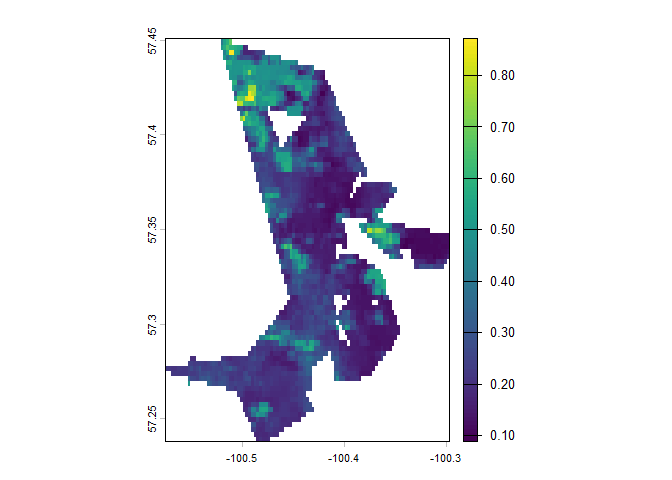

<!-- README.md is generated from README.Rmd. Please edit that file -->

# What is albedo?

Albedo can be thought of as a surface reflectance value given from 0 to
1, where 0 is a perfect blackbody, and 1 is a perfect reflector. Albedo
value can tell us about the composition of the surface (i.e. broadleaf
has higher values than conifer, snow has very high values while burnt
areas are closer to 0). Albedo also plays an important role in the
surface-energy budget, by indicating how much incoming radiation is
absorbed or reflected. Values near 0 represent greater absorption, while
values near 1 represent greater reflectance. Higher albedos can
contribute to net regional cooling, while lower albedos can contribute
to net regional warming.

# albedofindr

<!-- badges: start -->

<!-- badges: end -->

The goal of albedofindr is to calculate albedo for Landsat versions 5,
7, and 8, using Liang et al’s (2001) narrowband-to-broadband conversion
linear regression. Landsat does not have a native albedo product, so it
is calculated as follows for Landsat 5 and 7 as (in ENVI bands):


For Landsat 8, *B1* is replaced with *B2*. This is because the *Coastal
Aerosol* band was introduced as *B1* in Landsat 8 and 9, and the *Blue*
band ( in Landsat 5
and 7) was moved to *B2* in Landsat 8 and 9.

**IMPORTANT CAVEAT** : Liang et al (2001) tends to overestimate albedo
(when compared to MODIS), especially in the winter. It is highly
recommended to only use this package for summer albedo calculations.
While the calculation within the package is clamped to \[0,1\], the
equation itself is unbounded, and is therefore, unreliable. The equation
was also derived only using summer imagery.

## Installation

You can install the development version of albedofindr from
[GitHub](https://github.com/) with:

``` r
# install.packages("pak")
pak::pak("hesses167/albedofindr")
```

## Example

Note: this package is dependent on Google Earth Engine, and requires a
Google Earth Engine account.

Add your own Earth Engine account details when using this package.

This example uses albedofindr to calculate and upload median albedo
(*med_albedo*) as an Earth Engine asset:

``` r
library(albedofindr)
library(rgee)
library(sf)

rgee::ee_Authenticate(user = "svhesse167@gmail.com", auth_mode = "notebook")
rgee::ee_Initialize(
  user = "svhesse167@gmail.com",
  drive = TRUE,
  project = "wildfires-albedo"
)

aoi <- sf_as_ee(sample_polygon_1995["geometry"])
aoi_geometry <- aoi$geometry()$bounds()


# 1997, two years post fire
median_albedo <- get_median_albedo(
  year = 1997,
  start_month = "July",
  start_day = 1,
  end_month = "September",
  end_day = 1,
  aoi = aoi_geometry
  )

task <- ee$batch$Export$image$toAsset(
    image = median_albedo,
    description = "test_median_albedo_1995_2y_postfire",
    assetId = "projects/wildfires-albedo/assets/median_albedo_1995_2y_postfire",
    region = aoi_geometry,
    scale = 300,
    maxPixels = 1e13
  )

task$start()## basic example code
```

Then, once the asset is uploaded to Earth Engine, it can be extracted
locally by the user:

``` r
library(terra)
library(stars)

median_albedo_asset <- ee$Image("projects/wildfires-albedo/assets/median_albedo_1995_2y_postfire")

ee_as_raster(
  image = median_albedo_asset,
  region = aoi_geometry,
  scale = 300,
  dsn = "data-raw/median_albedo_1995fireyear_1997img.tif"
)
```

Then, to plot the raster:

``` r
library(terra)
#> terra 1.9.46
library(sf)
#> Linking to GEOS 3.14.1, GDAL 3.12.1, PROJ 9.7.1; sf_use_s2() is TRUE
library(albedofindr)

load("./data/median_albedo_1995fireyear_1997img.rda")

albedo_raster <- rast(median_albedo_1995fireyear_1997img)

aoi_sf <- st_as_sf(sample_polygon_1995)
aoi_vector <- vect(aoi_sf)

albedo_cropped <- crop(albedo_raster, aoi_vector)
albedo_masked <- mask(albedo_cropped, aoi_vector)
plot(albedo_masked)
```


